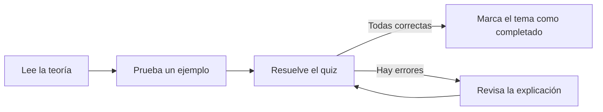

# ITERA Learn

**Laboratorio interactivo de métodos numéricos**

Aprende a estimar errores, comprobar la precisión de tus resultados y entender cómo se comportan los métodos iterativos. ITERA reúne teoría, ejemplos y práctica en el navegador.

**[Entrar al portal en GitHub Pages](https://suarezsh.github.io/itera-learn/)** · [Abrir el Módulo 1](https://suarezsh.github.io/itera-learn/modulo-1/)



## Capítulos disponibles

Los ocho módulos están disponibles. Se conserva el temario, el selector de módulos y la organización de temas por grupos. El examen se habilita al completar al menos el 75 % de los temas.

| Capítulo | Temas | Laboratorio | Examen / aprobación |
| --- | --- | --- | --- |
| [2 · Ecuaciones no lineales](https://suarezsh.github.io/itera-learn/modulo-2/) | 12 | Bisección, regla falsa, Newton, secante, punto fijo, Bairstow, Müller y sistemas | 36 / 24 |
| [3 · Sistemas lineales](https://suarezsh.github.io/itera-learn/modulo-3/) | 8 | Matrices, condición, eliminación, iterativos, LU, Cholesky, Thomas, potencia, QR y SVD | 24 / 16 |
| [4 · Ajuste e interpolación](https://suarezsh.github.io/itera-learn/modulo-4/) | 8 | Estadísticos, regresiones, QR/SVD, Newton, Lagrange y splines | 24 / 16 |
| [5 · Integración y diferenciación](https://suarezsh.github.io/itera-learn/modulo-5/) | 7 | Newton-Cotes, Romberg, cuatro familias gaussianas, integrales múltiples y derivadas | 21 / 14 |

Cada tema incluye objetivos, teoría, ejemplo resuelto, criterio o fórmula, errores frecuentes, laboratorio con tabla y procedimientos, práctica en tres niveles, código Python de referencia y tres preguntas propuestas. Las pistas de las opciones incorrectas no revelan la respuesta correcta. Se permite practicar respuestas escritas cuando la pregunta es numérica.

El avance se guarda en claves distintas por módulo (`itera-m2` a `itera-m5`), con exportación/importación JSON y reinicio confirmado. Cada examen tiene tres preguntas por tema y se aprueba con dos tercios de aciertos. Los módulos 6 al 8 también están disponibles, descritos a continuación. Los módulos 1 y 2 incluyen videos propios.

La web usa solo archivos estáticos y sus bibliotecas locales; los ejemplos Python con NumPy/SciPy son referencias de estudio y no dependencias de ejecución de la web. Consulta [alcance y comprobaciones](docs/modulos-2-al-5.md).

## Módulo 1 · Errores numéricos

| Sección | Qué aprenderás |
| --- | --- |
| 01 · Introducción | Cuándo conviene aproximar una solución y por qué hay que medir su error. |
| 02 · Redondeo y truncamiento | Cómo cambia un número al limitar sus decimales. |
| 03 · Error absoluto y relativo | Cómo medir la diferencia y ponerla en proporción al valor verdadero. |
| 04 · Clasificación de errores | Cómo distinguir errores inherentes, de truncamiento y de redondeo. |
| 05 · Cifras significativas | Qué dígitos expresan la precisión de una medición o un resultado. |
| 06 · Propagación | Cómo se transmiten las incertidumbres al operar con datos. |
| 07 · Condicionamiento | Cuánto puede cambiar un resultado ante una perturbación pequeña. |
| 08 · Convergencia | Cómo estimar la velocidad a la que disminuye el error. |

## Cómo se estudia



El desplegable del encabezado permite cambiar entre los ocho módulos. Puedes estudiar los temas en cualquier orden. El examen final de cada módulo se habilita cuando completas al menos el 75 % de sus temas.

- **Cinco calculadoras interactivas** con gráficos para redondeo, error absoluto y relativo, cifras significativas, propagación y convergencia.
- **Ejercicios con variantes**. Los ejercicios numéricos generan nuevos datos y recalculan sus respuestas. Las alternativas cambian de orden.
- **Examen de 24 preguntas** con selección y respuestas numéricas escritas. Se aprueba con 16 aciertos o más.
- **Recursos de acceso libre**. Puedes abrir el [video](https://suarezsh.github.io/itera-learn/modulo-1/#video) y el [formulario de errores numéricos](https://suarezsh.github.io/itera-learn/modulo-1/#formulas) en cualquier momento.

## Ejecutar en local

El portal usa HTML, CSS y JavaScript. Desde la carpeta del repositorio, inicia un servidor estático con Python.

```powershell
python -m http.server 8000
```

Abre el [portal local](http://localhost:8000/). La página guarda el progreso en el navegador. Se requiere conexión a internet para cargar las bibliotecas externas y el video de YouTube.

## Mejoras del módulo 1

- El progreso comienza en cero y se conserva por navegador. Cada tema exige 100 % en el cuestionario; hay intentos ilimitados. Los nuevos exámenes exigen 16/24. Los intentos antiguos conservan su longitud y el umbral de dos tercios.
- Objetivos, errores frecuentes, ejemplos de interpretación y práctica adicional con tres niveles en los ocho temas. La práctica no modifica el progreso.
- Laboratorio de condicionamiento para f(x)=1/(1−x), con comparación entre sensibilidad local y perturbación real.
- Explicaciones de las calculadoras y diagnóstico del examen por tema. Las preguntas de redondeo exigen el resultado solicitado; las demás respuestas escritas aceptan un error relativo de 0.05 %, anunciado al responder.
- Resumen del módulo y referencias de Cornell y NIST en el formulario.
- CSS y lógica separados en `modulo.css`, `modulo.js` y `mejoras.js`.
- KaTeX, Chart.js, Prism y Font Awesome se sirven localmente. Las fuentes web usan las alternativas del sistema si falla la red. El video sigue requiriendo internet. No hay caché para abrir una página no cargada sin servidor ni conexión.

## Verificación

Para las pruebas de desarrollo (no hace falta Node para estudiar):

```powershell
npm install
npm test
```

Para comprobar navegador, inicia el servidor Python en otra terminal y ejecuta:

```powershell
npm run test:browser
```

La prueba usa Microsoft Edge si está instalado en su ruta habitual de Windows; en otros sistemas instala Chromium con `npx playwright install chromium`.

Las pruebas cubren avance y desbloqueos, casos límite de calculadoras, tolerancia de respuestas, práctica, diagnóstico y generación aleatoria. La prueba de navegador comprueba escritorio y móvil, desbordamiento y cálculo después de perder la conexión. Las capturas de QA se escriben en la carpeta temporal de Windows.

### Retroalimentación al elegir alternativas

En los cuestionarios de tema y la práctica adicional, una selección incorrecta muestra una explicación del distractor o una pista del procedimiento, sin marcar la alternativa correcta ni mostrar la solución. Se permite seguir intentando en la misma pregunta. Al acertar se confirma la selección y se muestra su explicación. Las alternativas de la práctica adicional se mezclan en cada ejercicio, conservando el índice correcto. El examen final mantiene su revisión al finalizar.

## Revisión del capítulo 1 y ampliación didáctica

El libro base está en `libros/Metodos_Numericos_Cabrera_Orozco_2024.pdf`. El mapa del tema 1 enlaza las secciones 1.1–1.13 y sus páginas impresas. Condicionamiento y convergencia son ampliaciones, identificadas como A y B, sin atribuirles numeración del libro.

Se incorporaron diferencias importantes respecto a la primera versión: empates al par como opción predeterminada del libro, distinción entre error y cota, normalización respecto al verdadero frente al valor central, las cinco categorías del capítulo, criterio absoluto de cifras exactas, cocientes y raíces, y un caso integrador con unidades. El umbral relativo anterior queda identificado como orientativo, sin equivalencia universal con el criterio absoluto. No se copiaron los errores aritméticos del texto: los ejemplos añadidos son propios y se verifican por cálculo independiente.

Los nuevos cuestionarios incluyen preguntas adicionales de procedimientos e interpretación. La práctica genera niveles distintos y mezcla sus alternativas. Los nuevos exámenes tienen 24 preguntas, tres por cada tema, y se aprueban con 16. Los intentos guardados anteriormente se conservan; un nuevo intento usa el banco actualizado. Las respuestas escritas porcentuales piden el número sin el símbolo %, y las de redondeo respetan la regla declarada.

En «Guardar / recuperar progreso» se exporta un respaldo JSON, se importa con validación y confirmación, o se reinicia con confirmación. Solo se modifica el almacenamiento del módulo 1. Los respaldos se procesan localmente y no se envían a un servidor. Es una herramienta de autoaprendizaje: el archivo de progreso no es una certificación verificable de resultados.

El video propio está en producción y queda fuera de esta actualización. El recurso audiovisual externo existente se conserva.

Detalles de la revisión y límites: `docs/revision-modulo-1.md`.

Los temas ya aprobados permiten «Practicar otra evaluación» con el banco ampliado sin perder su marca de avance. Los respaldos conservan esas marcas aunque la nueva práctica todavía no esté resuelta.

## Capítulos 6, 7 y 8

Se completaron las secciones que ya figuraban en el portal, conservando orden, navegación y el formato de estudio de los demás módulos.

| Capítulo | Temas | Herramientas principales | Examen / aprobación |
| --- | --- | --- | --- |
| [6 · Ecuaciones diferenciales](https://suarezsh.github.io/itera-learn/modulo-6/) | 7 | Euler, Heun, Taylor 2, RK4/RK45, sistemas, Adams/Milne, Euler implícito, disparo, diferencias finitas y tres tipos de EDP | 21 / 14 |
| [7 · Optimización](https://suarezsh.github.io/itera-learn/modulo-7/) | 6 | Sección dorada, Newton, gradiente, Gauss-Newton, Levenberg-Marquardt y simplex | 18 / 12 |
| [8 · Implementación y validación](https://suarezsh.github.io/itera-learn/modulo-8/) | 4 | Bits binary64, suma decimal exacta, cancelación, sumas compensadas, refinamiento y Monte Carlo reproducible | 12 / 8 |

Los tres incluyen teoría, objetivos, ejemplos, preguntas con pistas sin revelar la correcta, práctica por nivel, respuesta escrita, examen equilibrado, referencias y respaldo JSON. Se guarda avance en `itera-m6`, `itera-m7` e `itera-m8` sin afectar otros módulos. Se incorporaron 36 opciones nuevas de laboratorio; las tres requieren únicamente los archivos estáticos locales para calcular.

El capítulo 6 sigue el libro base, con ampliaciones ya previstas en el portal. Los capítulos 7 y 8 son complementarios y se identifican así: no se presentan como capítulos de ese libro. El video propio continúa fuera de esta implementación.

Límites, referencias y pruebas: [capítulos 6 al 8](docs/modulos-6-al-8.md).

## Presentación de fórmulas

Los módulos 2 al 8 usan el mismo KaTeX local y estilos de tarjetas del módulo 1. Las fórmulas de los 52 temas, sus formularios y las expresiones de los ejemplos resueltos se renderizan con fracciones, raíces, matrices, sumatorias y subíndices reales. El catálogo explícito de 156 expresiones está en `assets/course/formulas.js`; no se interpreta como TeX el contenido de los respaldos ni la entrada de las calculadoras.

El formulario usa la misma cuadrícula responsiva del módulo 1. Las expresiones largas se distribuyen en varias líneas; si necesitan más ancho, tienen desplazamiento horizontal con aviso y foco por teclado. KaTeX genera HTML y MathML para lectura accesible. Las bibliotecas y fuentes matemáticas se sirven desde los archivos locales.

Validación: `npm run test:formulas`; con servidor en 8000, `npm run test:formulas:browser`. Se revisaron las vistas de los módulos 2 al 8 en 390, 768 y 1440 px y el módulo 1 como referencia. Esta actualización cambia la presentación y no los algoritmos de cálculo ni el progreso guardado.

## Panel principal

La portada usa `assets/course/home.css` y `assets/course/home.js`. El panel suma los 60 temas interactivos de los ocho módulos, conserva sus claves de almacenamiento y dirige el botón Continuar al primer tema pendiente. Los indicadores del temario cuentan también sus secciones y subsecciones de lectura. Los accesos rápidos abren los dos videos propios y el libro base.

La demostración SVG muestra cinco aproximaciones reales de Newton para √2. Tiene control de pausa, respeta movimiento reducido y suspende sus actualizaciones fuera de pantalla o con la pestaña oculta. Las tarjetas de módulos no tienen bordes intermitentes ni animación de aparición. Los iconos se sirven desde archivos locales.

Con un servidor local en el puerto 8000, `npm run test:home:browser` verifica progreso, reanudación, datos locales dañados, búsqueda, navegación, tema, movimiento reducido y seis anchos entre 360 y 1920 px.

## Publicación

GitHub Pages se publica con `.github/workflows/pages.yml` desde `main`. El flujo copia la portada, los ocho módulos, recursos, libros y videos a la raíz del artefacto; no ejecuta Jekyll. En Settings → Pages, la fuente debe ser **GitHub Actions**. El resultado de cada publicación se consulta en [Actions](https://github.com/Suarezsh/itera-learn/actions/workflows/pages.yml).


## Revisión de observaciones del Grupo 3 (19/11/2026)

Se incorporaron contadores estables, índices correlativos, tolerancia base 10⁻⁶, exportación CSV, comparación y refinamiento de integración y EDO, respaldo de progreso, resúmenes, historial local y atribución del libro. El registro de alcance, evidencias y limitaciones está en [la revisión del Grupo 3](docs/revision-grupo-3-2026-11-19.md). La URL, despliegue, portal común y videos quedan fuera de esta revisión por indicación del responsable.

Verificación específica con servidor local en el puerto 8000: `npm run test:review`. Las pruebas generales se ejecutan con `npm test` y `npm run test:browser`.
